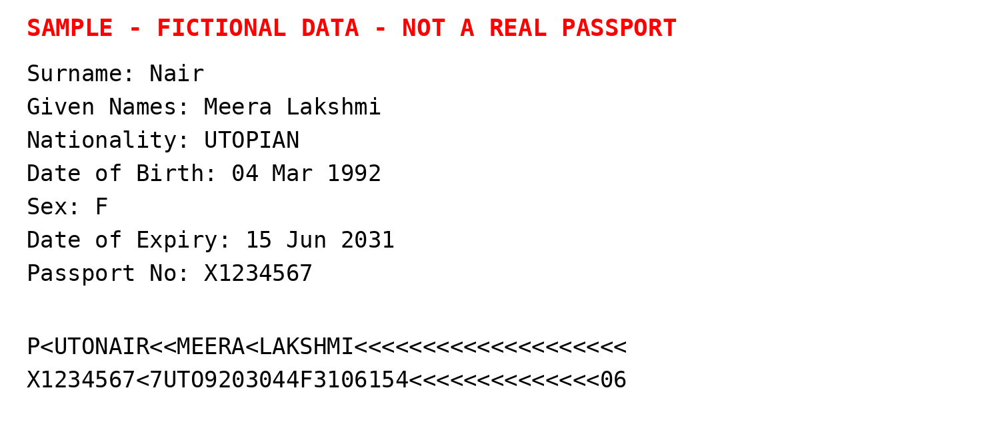
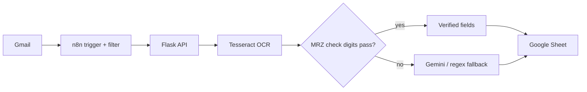

# Visa Passport Processor

[](https://github.com/AyishaThahira-CH/visa-passport-processor/actions)


An automation pipeline that watches a Gmail inbox for visa-related emails, reads the passport
attached to each one with **OCR + MRZ check-digit validation (Gemini optional)**, and appends the
structured result to a Google Sheet. No manual data entry.

> All sample data in this repository is **fictional**. Never commit real passports.

## Live demo

**🔗 [Try it in your browser](https://huggingface.co/spaces/AyishaThahira-CH/visa-passport-processor)** (upload a fictional passport, or click *Try valid sample* / *Try expired sample*).
The page shows the extracted fields, whether the MRZ check digits passed, the raw OCR text and the JSON response.

Run the same demo locally (no Gmail or Google account needed):

```bash
DEMO_MODE=1 python -m visa_processor.api   # then open http://127.0.0.1:5000
```

Or from the command line:

```bash
python scripts/process_file.py samples/sample_passport.png
```

```json
{
  "full_name": "MEERA LAKSHMI NAIR",
  "passport_number": "X1234567",
  "nationality": "UTO",
  "issuing_country": "UTO",
  "date_of_birth": "1992-03-04",
  "expiry_date": "2031-06-15",
  "gender": "F",
  "missing_fields": [],
  "warnings": [],
  "extraction_method": "mrz",
  "is_valid": true
}
```



## How it works



1. **n8n** polls Gmail every minute, keeps emails whose subject contains "visa", downloads the attachment and classifies the visa type from the subject.
2. n8n POSTs the file to the **Flask API** (`/process-passport`, protected by `X-API-Key`).
3. The API OCRs the file, then extracts fields in this order of trust:
   **MRZ with verified check digits → Gemini → regex**.
4. n8n appends the returned JSON as a new row in Google Sheets.

More detail and design decisions: [docs/architecture.md](docs/architecture.md) and [docs/ENGINEERING_NOTES.md](docs/ENGINEERING_NOTES.md).

## Quick start

**Prerequisites:** Python 3.12, Tesseract and Poppler (`sudo apt install tesseract-ocr poppler-utils`).

```bash
git clone https://github.com/AyishaThahira-CH/visa-passport-processor.git
cd visa-passport-processor
pip install -r requirements.txt
cp .env.example .env          # then edit API_KEY (and optionally GEMINI_API_KEY)
set -a; source .env; set +a
python -m visa_processor.api  # http://127.0.0.1:5000
```

```bash
curl -s http://127.0.0.1:5000/health
curl -s -X POST http://127.0.0.1:5000/process-passport \
  -H "Content-Type: application/json" -H "X-API-Key: $API_KEY" \
  -d "{\"filename\":\"sample_passport.png\",\"visa_type\":\"Work Visa\",\"attachment_base64\":\"$(base64 -w0 samples/sample_passport.png)\"}"
```

### Docker

```bash
docker build -t visa-processor .
docker run -p 127.0.0.1:5000:5000 -e API_KEY=change-me visa-processor   # API for n8n
docker run -p 5000:5000 -e DEMO_MODE=1 visa-processor                  # public demo page
```

Free public hosting for the demo: [deploy/HUGGINGFACE.md](deploy/HUGGINGFACE.md).

### Full Gmail → Sheets automation

1. Create an OAuth client in Google Cloud Console, save it as `credentials.json`.
2. `python scripts/setup_google.py --create-sheet` (authorises Gmail read-only + Sheets, creates a **private** sheet).
3. Start n8n (`npx n8n`), import [`n8n/workflow.json`](n8n/workflow.json), connect your Gmail and Google Sheets credentials, and paste your API key and sheet ID into the two marked fields.
4. Email yourself a test message with "visa" in the subject and `samples/sample_passport.png` attached, run the workflow once, then activate it.

Full walkthrough with troubleshooting: [docs/N8N_SETUP.md](docs/N8N_SETUP.md).

## API

`POST /process-passport` with JSON:

| Field | Required | Notes |
|---|---|---|
| `attachment_base64` | one of | base64 of a PDF/JPG/PNG (max `MAX_UPLOAD_MB`) |
| `email_id` | one of | fallback: the API fetches the attachment from Gmail |
| `filename`, `visa_type`, `email_from`, `email_subject` | no | passed through to the response |

Responses: `200` success, `400` bad input, `401` bad API key, `413` too large, `422` no text found, `500` internal error.

`is_valid` is `true` only when all five required fields are present **and** the passport is not expired. `warnings` explains anything unusual (expired, MRZ checksum failed, Gemini fell back to regex).

## Configuration

| Variable | Default | Purpose |
|---|---|---|
| `API_KEY` | *(empty = no auth)* | shared secret expected in `X-API-Key` |
| `GEMINI_API_KEY` | *(empty)* | enables the Gemini fallback |
| `GEMINI_MODEL` | `gemini-2.5-flash` | model name; check Google's docs for currently supported models |
| `DEMO_MODE` | *(off)* | serves the browser demo page; disables `/process-passport` unless `API_KEY` is set |
| `DEMO_RATE_LIMIT` | `20` | demo requests per visitor per 10 minutes |
| `HOST` / `PORT` | `127.0.0.1` / `5000` | bind address |
| `MAX_UPLOAD_MB`, `MAX_PDF_PAGES` | `10`, `5` | abuse limits |

## Tests

```bash
pip install -r requirements-dev.txt
python -m pytest -q
```

Covers MRZ check digits, repair of real Tesseract mistakes, regex regressions, and the API (auth, validation, path-traversal filenames, bad base64).

## Security and privacy

- The API refuses unauthenticated calls when `API_KEY` is set and binds to localhost by default.
- Uploads are validated by extension and size; filenames are sanitised.
- Passport files live in a temporary directory that is deleted even if processing fails; no passport data is logged.
- The Google Sheet is created **private**. Do not share it: it contains personal data.
- Secrets (`.env`, `credentials.json`, `token.json`) are git-ignored.

## Limitations

- Supports TD3 passports (2 × 44 character MRZ). ID cards and other layouts use the Gemini/regex fallback.
- Tesseract can misread MRZ characters; the repair step plus check digits catches most cases, but low-quality scans may still fall back to regex or fail.
- Intended for a single-machine setup; a production deployment would add a job queue and encrypted storage.

## Project structure

```
visa_processor/   api.py, ocr.py, mrz.py, extract.py, gmail.py, config.py, static/demo.html
scripts/          setup_google.py, process_file.py
n8n/              workflow.json
tests/            pytest suite
docs/             architecture, engineering notes, n8n setup guide
deploy/           free hosting guide for the demo
samples/          fictional sample passports (valid + expired)
```

## License

MIT, see [LICENSE](LICENSE).
