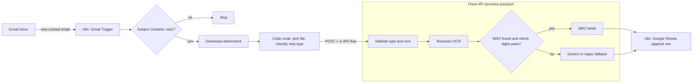

# Architecture

## Design decisions

| Decision | Why |
|---|---|
| MRZ parsing with check digits first | Deterministic and verifiable; an LLM can silently hallucinate a digit, a checksum cannot |
| OCR repair step before checksum validation | Tesseract confuses `<` / `O` / `0`; layout-aware repair is safe because checksums still gate the result |
| Gemini only as a fallback, key from environment | No secret travels in request bodies or process arguments |
| Temp files in a `TemporaryDirectory` | Passport scans are deleted even if OCR crashes |
| `X-API-Key` + localhost bind | The API handles identity documents and must not be open |
| Private Google Sheet | The output is PII; the old setup script made it world-editable |
